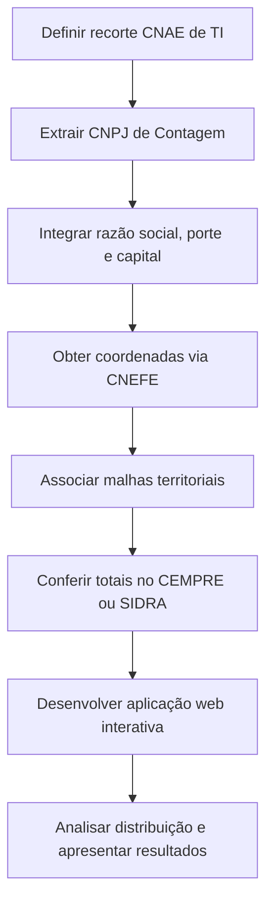

# A Implementação de um Mapa Interativo Sobre as Empresas de TI do Município de Contagem

## Introdução

O uso de dados para compreender a dinâmica econômica de um município pode contribuir para a identificação de características relacionadas à distribuição das atividades econômicas, à ocupação territorial e ao desenvolvimento de determinados setores.
Nesse contexto, dados produzidos e mantidos por órgãos públicos podem ser utilizados não apenas para fins administrativos, mas também para produzir informações que auxiliem cidadãos, empresas, pesquisadores e gestores na compreensão do ambiente econômico local.
Parte desses registros é publicada como dado aberto, em arquivos que cobrem o Brasil ou uma unidade da federação e que podem ser filtrados até o município.
Nenhuma dessas fontes, isoladamente, reúne a identificação do estabelecimento, a atividade econômica e a coordenada geográfica.
Assim, conhecer um setor em uma cidade exige cruzar dados de mais de uma instituição.

A existência de dados abertos com essas características oferece diferentes possibilidades de análise, porém a disponibilização das informações em sua forma original não necessariamente proporciona uma compreensão simples e acessível para diferentes públicos.
Os arquivos podem conter uma quantidade significativa de registros, classificações e atributos geográficos, dispersos em mais de uma fonte, o que dificulta sua interpretação quando analisados diretamente em tabelas ou arquivos isolados.
Segundo Ansari (2022), apesar do aumento da disponibilidade de dados governamentais, sua utilização ainda pode ser limitada, e o emprego de mecanismos de visualização pode tornar essas informações mais compreensíveis, úteis e acessíveis.
Diante desse cenário, este trabalho busca responder à seguinte questão de pesquisa: como dados abertos podem ser combinados para caracterizar e apresentar, de maneira acessível e interativa, informações sobre as empresas do setor de Tecnologia da Informação localizadas no município de Contagem?
Além da caracterização geral dessas empresas, pretende-se explorar sua distribuição territorial a partir da integração entre os endereços dos estabelecimentos e bases geográficas abertas, sem limitar a análise ao aspecto espacial.

Para responder a essa questão, o objetivo geral deste trabalho é desenvolver uma aplicação web interativa que permita caracterizar e visualizar as empresas do setor de Tecnologia da Informação do município de Contagem a partir da integração de dados abertos.
A aplicação reunirá indicadores, gráficos, mapas, tabelas e mecanismos de filtragem, ajustados à estrutura e à qualidade das fontes utilizadas.

Como objetivos específicos, pretende-se:

\begin{itemize}
    \item identificar as fontes de dados abertos pertinentes e mapear os atributos e as chaves que permitem integrá-las para o recorte municipal;
    \item caracterizar as empresas de Tecnologia da Informação localizadas em Contagem, com base na classificação CNAE e nos atributos disponíveis nas bases integradas;
    \item analisar a distribuição geográfica dessas empresas a partir das coordenadas obtidas pela integração entre endereço e bases territoriais abertas;
    \item desenvolver a aplicação web interativa que permita ao usuário consultar, filtrar e interpretar as informações por meio de visualizações e tabelas.
\end{itemize}

A relevância deste estudo justifica-se pela necessidade de aproximar dados públicos, hoje dispersos e pouco acessíveis em sua forma bruta, de públicos que podem utilizá-los na prática.
Como por exemplo:

\begin{itemize}
    \item cidadãos poderão conhecer melhor as empresas de tecnologia existentes no município;
    \item profissionais poderão identificar organizações relacionadas às suas áreas de interesse;
    \item empresários poderão utilizar as informações para conhecer empresas do mesmo setor e identificar possíveis fornecedores ou parceiros;
    \item empreendedores poderão explorar características da distribuição das atividades econômicas no município.
\end{itemize}

Sob a perspectiva acadêmica, o trabalho contribui para a área de Sistemas de Informação ao integrar dados abertos, análise descritiva e visualização interativa em um recorte municipal concreto, alinhado a estudos que relacionam localização e setor de tecnologia em contextos urbanos, como o de Zenka (2021).
A escolha do tema pauta-se na formação em Sistemas de Informação e no interesse por soluções que transformem bases públicas em instrumentos de consulta e interpretação para usuários não especializados.

Este trabalho está estruturado em sete capítulos.
Após esta introdução, o Capítulo 2 apresenta o referencial teórico, e o Capítulo 3 os trabalhos relacionados.
O Capítulo 4 descreve a metodologia empregada, incluindo a obtenção e a integração das bases de dados abertos e os critérios de identificação do setor.
O Capítulo 5 detalha o desenvolvimento da aplicação web.
O Capítulo 6 apresenta e discute os resultados obtidos, bem como a aplicação desenvolvida.
Por fim, o Capítulo 7 apresenta as conclusões do trabalho, suas limitações e as possibilidades de continuidade da pesquisa.

## Referencial Teórico

Este capítulo apresenta os conceitos que fundamentam o trabalho.
São tratados, em sequência, dados abertos, classificação de atividades econômicas (CNAE), distribuição geográfica das empresas e aplicações web interativas.

### Dados abertos governamentais

Dados abertos governamentais são informações produzidas ou mantidas pelo poder público e disponibilizadas para que outras pessoas possam usá-las de novo. O objetivo costuma ser aumentar a transparência, a participação e a inovação. Attard et al. (2015), em revisão de iniciativas nessa área, descrevem um ciclo que inclui publicar e usar os dados. Os autores mostram que só abrir a base não basta: o valor depende dos processos, dos formatos e das regras de uso. Em linha parecida, Janssen, Charalabidis e Zuiderwijk (2012) dizem que os benefícios esperados convivem com barreiras de instituição, lei, técnica e qualidade dos dados, além da dificuldade das tarefas pedidas ao usuário. Assim, ter arquivos públicos disponíveis não garante que eles sejam fáceis de entender ou de reutilizar. Para o uso funcionar na prática, é preciso tratar, combinar e apresentar os dados de forma adequada ao público. Esse raciocínio apoia a ideia deste trabalho: caracterizar as empresas de Tecnologia da Informação em Contagem a partir de bases abertas nacionais e estaduais, e não a partir de um único arquivo municipal já pronto.

### Visualização de dados e usabilidade

A visualização de dados é apresentada na literatura como estratégia para reduzir a distância entre a publicação do dado e o seu uso por pessoas sem domínio técnico avançado.
Graves e Hendler (2013) sustentam que parcela relevante da população poderia se beneficiar de dados abertos, mas não consegue coletar, processar, combinar e interpretar esses registros sem ferramentas que simplifiquem essas operações.
Os autores defendem visualizações e mecanismos exploratórios sobre dados e metadados como meio de comunicação e de apoio à criação de sentido.
Janssen, Charalabidis e Zuiderwijk (2012) convergem nesse ponto ao indicar que recursos de visualização podem diminuir barreiras de uso para usuários pouco experientes, desde que as iniciativas considerem a perspectiva de quem consome a informação.
Ansari (2022) aprofunda essa discussão ao revisar pesquisas sobre visualização de dados governamentais abertos e observar que, apesar do crescimento de casos e ferramentas, ainda há lacunas na avaliação de usabilidade para públicos distintos.
Para o autor, plataformas que embutem gráficos, mapas e recursos analíticos tendem a ampliar a utilidade do dado em relação à entrega isolada de arquivos.
Esse conjunto de contribuições fundamenta a opção por uma aplicação que reúna indicadores, tabelas, filtros e representações geográficas, em vez de limitar a contribuição do trabalho à disponibilização de planilhas tratadas.

### Classificação de atividades econômicas e integração de bases

A identificação de um setor econômico em cadastros administrativos e estatísticos depende de uma classificação padronizada das atividades.
No Brasil, a Classificação Nacional de Atividades Econômicas (CNAE), mantida pelo IBGE no âmbito da CONCLA, é o instrumento oficial adotado pelo sistema estatístico nacional e pelos órgãos gestores de registros administrativos (IBGE, 2020).
A CNAE organiza as atividades em hierarquia e, na versão de subclasses para uso da Administração Pública, detalha categorias empregadas em cadastros de pessoa jurídica.
Essa padronização permite filtrar estabelecimentos do setor de Tecnologia da Informação por códigos de atividade, em especial na divisão associada a serviços de TI, e comparar resultados com estatísticas oficiais agregadas.
Contudo, a classificação resolve apenas parte do problema.
Attard et al. (2015) enfatizam que o consumo de dados abertos envolve etapas de obtenção, transformação e combinação de fontes.
Graves e Hendler (2013) reforçam que mesclar conjuntos distintos é uma das operações que afastam usuários leigos do aproveitamento direto dos portais.
No caso deste trabalho, a caracterização municipal exige integrar cadastros de estabelecimentos, tabelas de referência de atividade e município, bases de endereço com coordenadas e malhas territoriais.
A integração, portanto, não é detalhe operacional: é condição para que a CNAE, o endereço e a localização espacial passem a compor um mesmo conjunto analisável.

### Distribuição espacial de empresas e geovisualização

A localização das empresas no território é um atributo analítico, e não apenas um campo cadastral.
Estudos sobre a distribuição intramunicipal de firmas de Tecnologia da Informação e Comunicação mostram que padrões de concentração podem ser identificados quando há informação geográfica adequada.
Zenka (2021), ao investigar Ostrava, evidencia agrupamentos relevantes no centro e na cidade interior, com associação a tipologias urbanas específicas, e demonstra o valor de analisar a posição das empresas além da contagem agregada por município.
Embora o contexto daquele estudo diferencie-se de Contagem, a contribuição conceitual permanece: a geografia intramunicipal ajuda a interpretar como o setor se organiza no espaço urbano.
Para tornar essa geografia legível, a literatura de cartografia interativa e geovisualização discute o papel da exploração visual.
Roth (2013) propõe uma taxonomia de primitivas de interação em cartografia e geovisualização, destacando operações como filtrar, ampliar, consultar e reordenar a representação como parte do raciocínio espacial mediado por mapas.
Em diálogo com a agenda de dados abertos, Ansari (2022) inclui mapas entre os mecanismos capazes de ampliar a compreensão de conjuntos governamentais.
A síntese dessas linhas orienta o presente estudo: a coordenada estimada a partir do endereço e das bases territoriais abertas não substitui, por si só, a análise; ela alimenta representações — pontos, mapas de calor e agregações por recortes do município — que permitem observar concentração, vazios e diferenças internas.

### Aplicações web interativas para exploração de dados

A materialização prática dos conceitos anteriores, no escopo de Sistemas de Informação, ocorre por meio de aplicações que integrem consulta, filtragem e visualização em uma interface acessível.
Graves e Hendler (2013) defendem ferramentas que reduzam a necessidade de expertise técnica para explorar dados abertos e que apoiem a navegação por metadados e a construção de visualizações.
Ansari (2022) recomenda plataformas avançadas com visualizações e recursos analíticos embutidos, associadas a avaliação do uso por diferentes stakeholders.
Roth (2013), no domínio cartográfico, mostra que a interatividade não é adorno: ela estrutura a forma como o usuário formula e responde perguntas espaciais sobre o mapa.
Combinadas, essas contribuições sustentam o quarto objetivo específico deste trabalho: desenvolver uma aplicação web interativa na qual indicadores, gráficos, mapas e tabelas operem sobre a base integrada, permitindo que o usuário explore as empresas de Tecnologia da Informação de Contagem de acordo com os atributos disponíveis.
Assim, o referencial teórico conecta a abertura dos dados, a classificação da atividade, a leitura espacial e a interface de exploração em um mesmo encadeamento conceitual.

## Trabalhos Relacionados

## Metodologia

<!-- Substituir esse paragrafo por outro apresentando de forma mais ampla o objetivo da pesquisa -->

Este capítulo descreve como a pesquisa será conduzida, de modo a permitir a reprodução das etapas principais.
São apresentados o tipo de pesquisa, o objeto de estudo, as etapas do trabalho, as fontes de dados, o tratamento e a integração das bases, os procedimentos de análise, as ferramentas e os critérios de conferência dos resultados.

### Classificação da pesquisa

Quanto aos objetivos, a pesquisa classifica-se como descritiva.
Segundo Gil (2008), a pesquisa descritiva registra características de determinada população ou fenômeno e permite a organização dessas informações em tabelas, gráficos e outras formas de apresentação.
No presente trabalho, descrevem-se as empresas de Tecnologia da Informação localizadas em Contagem, a partir de atributos cadastrais e da distribuição geográfica observada nas bases abertas.

Quanto aos procedimentos, trata-se de pesquisa documental.
Utilizam-se documentos e bases oficiais já existentes, publicadas por órgãos públicos, e não a coleta direta de entrevistas ou questionários com pessoas.

Quanto à abordagem, adota-se o caráter misto.
A dimensão quantitativa aparece na contagem de estabelecimentos, na distribuição por subclasses da CNAE, por porte e por recortes territoriais.
A dimensão qualitativa aparece na interpretação dos padrões espaciais e na discussão das limitações das fontes, sem pretender estabelecer relações causais entre localização e desempenho econômico.

### Objeto de estudo e recorte

O objeto de estudo são os estabelecimentos de Tecnologia da Informação situados no município de Contagem (MG), identificados pelo código IBGE 3118601.
O setor será delimitado pela Classificação Nacional de Atividades Econômicas (CNAE), com recorte inicial na divisão 62, correspondente a atividades dos serviços de tecnologia da informação.
A unidade de análise será o estabelecimento constante do cadastro de CNPJ, e não a empresa como um todo: matriz e filial entram como registros distintos quando estiverem no município e na atividade selecionada.
Serão considerados, em regra, estabelecimentos com situação cadastral ativa na fotografia da base utilizada.
Não haverá participantes humanos nem aplicação de questionários; por isso, não se aplica tramitação em comitê de ética para coleta com pessoas.
Os dados empregados são públicos e abertos.

### Etapas do trabalho

<!-- Frase muito generica, substitua por: "Esta pesquisa será realizada em 4 etapas" -->
O desenvolvimento seguirá um conjunto encadeado de etapas, alinhado aos objetivos específicos.
A Figura 1 resume o fluxo geral.

As etapas serão as seguintes:

\begin{itemize}
    \item definir a lista de subclasses CNAE que representam o setor de TI no escopo do trabalho;
    \item extrair e filtrar os estabelecimentos de Contagem na base de CNPJ, conforme município, situação cadastral e CNAE;
    \item integrar atributos complementares, como razão social, porte e capital social, pela chave do CNPJ básico;
    \item obter latitude e longitude a partir do CNEFE, preferencialmente pela junção por CEP, com registro da qualidade do georreferenciamento;
    \item associar os pontos às malhas territoriais do IBGE para leitura por recortes do município;
    \item conferir a ordem de grandeza das contagens com estatísticas agregadas do CEMPRE ou do SIDRA;
    \item desenvolver a aplicação web interativa com indicadores, filtros, mapas, gráficos e tabelas;
    \item analisar a distribuição geográfica e discutir os resultados à luz das limitações das fontes.
\end{itemize}

### Fontes de dados e coleta

A coleta virá de bases abertas oficiais, por meio do download e da consulta a esses arquivos publicados por órgãos públicos.
A principal fonte para a lista de estabelecimentos será a base pública de CNPJ da Receita Federal do Brasil, que reúne identificação, CNAE, situação cadastral e endereço declarado.
A estrutura e a descrição das atividades virão da CNAE mantida pelo IBGE, utilizada para fechar o recorte setorial.
As coordenadas geográficas serão obtidas no Cadastro Nacional de Endereços para Fins Estatísticos (CNEFE), do IBGE, associado ao Censo Demográfico.
As malhas territoriais do IBGE fornecerão o contorno do município e, quando disponíveis no nível adequado, recortes internos úteis à agregação espacial.
Para conferência de totais, serão consultadas tabelas do Cadastro Central de Empresas (CEMPRE) por meio do SIDRA, sempre no município de Contagem e em nível de CNAE compatível com o recorte.
Como apoio à extração, poderá ser utilizada a plataforma Base dos Dados, desde que os filtros reproduzam o mesmo universo da fonte oficial.
O mapa de fundo da aplicação utilizará tiles do OpenStreetMap.
Não se utilizará geocodificação em lote por serviços online para milhares de endereços; o CNEFE será a base prevista para essa etapa.

### Tratamento e integração das bases

Os arquivos nacionais não serão carregados integralmente na aplicação.
O tratamento ocorrerá em ambiente local, com filtragem prévia para Contagem e para as subclasses CNAE definidas.
A integração seguirá chaves explícitas: código de município da Receita para isolar Contagem; CNPJ básico para unir estabelecimentos e quadros de empresas; CNAE sem máscara para padronizar a atividade; código IBGE 3118601 para ligar o resultado às malhas, ao CNEFE e ao CEMPRE; CEP, e quando possível logradouro e número, para estimar a coordenada.
Cada estabelecimento georreferenciado receberá um indicador da origem do ponto, por exemplo coordenada associada ao CEP, tentativa por endereço ou ausência de localização.
Registros sem coordenada permanecerão na base analítica para contagens cadastrais, mas poderão ficar de fora das visualizações de mapa ou aparecer em categoria própria.
A base resultante será exportada em formato adequado ao consumo da aplicação, reduzindo volume e facilitando a reprodução do painel.

### Procedimentos de análise

A análise será descritiva e exploratória.
Serão calculados totais de estabelecimentos ativos no recorte, distribuições por subclasse CNAE e por porte, e indicadores de cobertura do georreferenciamento.
No eixo espacial, serão observados a concentração de pontos no município, eventuais vazios e a agregação por recortes territoriais disponíveis nas malhas.
Mapas de pontos e, quando fizer sentido, representações de densidade auxiliarão a leitura da distribuição.
A comparação com o CEMPRE não buscará igualdade exata de números, pois as fotografias temporais e os critérios de cada base diferem; buscará verificar se a ordem de grandeza é coerente.
Os resultados dessa análise serão apresentados em tabelas, gráficos e mapas, e discutidos no capítulo de resultados.

### Desenvolvimento da aplicação e ferramentas

A aplicação web será o meio de consulta e exploração da base integrada.
Ela reunirá indicadores, filtros, tabelas, gráficos e mapa interativo, permitindo ao usuário examinar os estabelecimentos de TI de Contagem conforme os atributos disponíveis.
Para o tratamento dos dados, serão utilizadas ferramentas de análise e manipulação tabular em linguagem Python, com apoio de bibliotecas adequadas à leitura de arquivos grandes e à filtragem por município e CNAE.
Para a interface, serão empregados recursos de desenvolvimento web e biblioteca de mapas interativos compatível com tiles do OpenStreetMap.
O detalhamento da arquitetura, das telas e das decisões de implementação será apresentado no capítulo de desenvolvimento.
As versões das bases, as datas de download e as regras de filtro serão registradas para tornar o processo auditável.

### Limitações metodológicas previstas

Algumas limitações são inerentes às fontes e serão tratadas com transparência.
O CNAE reflete a atividade declarada no cadastro, e não uma auditoria do que a empresa executa no dia a dia.
A coordenada obtida pelo CNEFE é uma estimativa a partir do endereço ou do CEP, e não uma localização oficial do estabelecimento no terreno.
Porte e capital social estão disponíveis no CNPJ; já o pessoal ocupado por empresa, em geral, não está de forma pública e identificável nas bases abertas usadas neste trabalho.
Totais do CEMPRE e da RAIS não substituem a lista de CNPJs no mapa e não devem ser lidos como a mesma contagem.
Essas restrições não invalidam o estudo; delimitam o que os resultados podem afirmar com segurança.

## Desenvolvimento

## Resultados

## Considerações Finais
